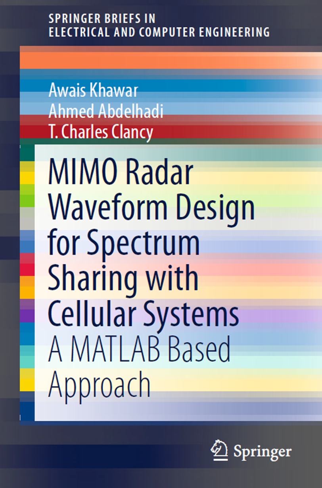

# 1. MIMO Radar Waveform Design for Spectrum Sharing with Cell

Introduction:  
An interesting concept in the next generation of radar is Multi-Input Multi-Output (MIMO) radar systems; this has been an active research area over the past few years. MIMO radar can be categorized into two types: large-aperture (where antenna elements are spaced apart by a significant distance) and co-located (where antenna elements are closely spaced). MIMO radar can transmit multiple signals through its antenna elements, which can be different from each other, thus creating waveform diversity. This makes MIMO radar more advantageous than traditional phased array radar systems, as traditional phased array radar systems can only emit scaled versions of a single waveform, thus failing to utilize waveform diversity.  
This book primarily introduces common radar models, interference channel models, spectrum sharing scenarios, radar waveforms transmitted simultaneously via BSPK and QPSK, and their integration with MIMO for spectrum sharing. It also analyzes the application of waveforms under stationary and moving scenarios, ending with relevant MATLAB code included at the end of the book.

## Images

<!-- PAYMENT_BLOCK -->

## Get this dataset

- Payment link (Stripe): [Buy now](https://buy.stripe.com/3cs8yP7sY87d0vu9AB)
- Payment QR code: 

<!-- /PAYMENT_BLOCK -->
